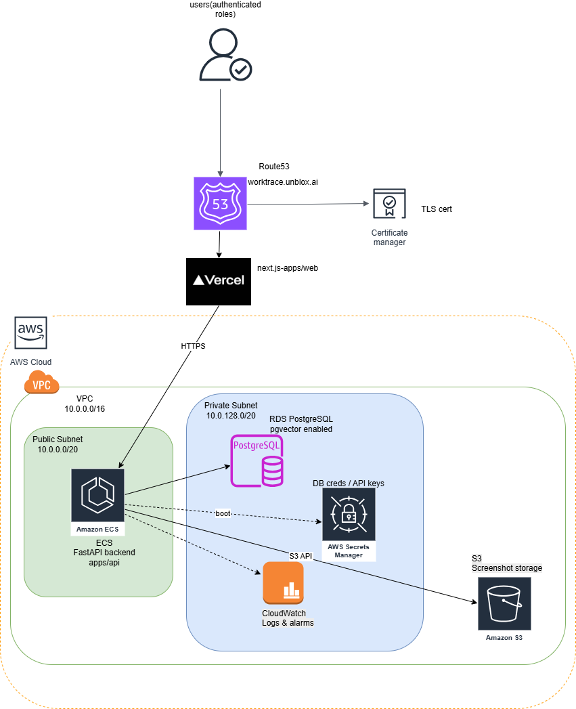

# Deployment

## Architecture



Source diagram: [`docs/architecture/aws-deployment.drawio`](./architecture/aws-deployment.png)

## Frontend — Vercel preview deploys

The Next.js frontend (`apps/web`) is deployed to Vercel. Every PR gets its own
preview URL, posted automatically as a comment on the PR. Merges into `main`
update the production URL.

### One-time setup (do this once, not per-developer)

Whoever has admin access to the GitHub repo does this once:

1. Sign in to <https://vercel.com> with the GitHub account that owns/admins the
   repo. Use the free Hobby plan.
2. Click **Add New… → Project**, then import
   `unsw-cse-comp99-3900/capstone-project-26t2-3900-h09a-apple`.
3. In the configuration screen:
   - **Framework Preset**: Next.js (auto-detected)
   - **Root Directory**: `apps/web`
   - **Install Command**: leave default (`pnpm install`)
   - **Build Command**: leave default (`next build`)
   - **Output Directory**: leave default (`.next`)
4. Under **Environment Variables**, add at least:
   - `NEXT_PUBLIC_API_BASE_URL` — for now, a placeholder like
   - `NEXT_PUBLIC_APP_NAME` — `H09A Apple`
5. Add the production domain:
   - `worktrace.unblox.ai`

After this, no further action is needed: every PR push automatically triggers a
preview build and Vercel posts the URL on the PR.

### Verifying it works

Open any PR. Within ~2 minutes the **Vercel bot** should comment with a preview
URL like `https://h09a-apple-pr-12-h09a-apple.vercel.app`. Click it — the
homepage should load.

### When the backend is deployed later

Update `NEXT_PUBLIC_API_BASE_URL` in Vercel project settings to point at the
real backend URL. Vercel rebuilds previews automatically on the next push.

## Backend - AWS ECS Fargate

The FastAPI backend (`apps/api`) is deployed as a Docker container on AWS ECS
Fargate. The original target was AWS App Runner, but App Runner is unavailable
for this AWS account because AWS no longer accepts new App Runner customers.
ECS Fargate is the replacement backend container service.

Production backend URL: deployed on AWS ECS Fargate behind an application
load balancer. Not required for the local assessor path; see
`DEPLOYMENT_GUIDE.md`.
Health check: `GET /api/v1/health` (also `GET /health`)

### AWS services

- Application Load Balancer: public backend entrypoint
- ECS Fargate Service: FastAPI backend
- ECR: backend Docker image
- AWS RDS PostgreSQL: application database
- pgvector: enabled with `CREATE EXTENSION IF NOT EXISTS vector`
- AWS S3: screenshot object storage
- AWS Secrets Manager: database credentials and API secrets
- AWS CloudWatch: ECS task logs and health alarms

### ECS environment variables

Do not commit real secret values to the repository.

- `DATABASE_URL`
- `SECRET_KEY`
- `API_CORS_ORIGINS`
- `OPENAI_API_KEY`
- `OPENAI_MODEL`
- `S3_BUCKET_NAME`
- `S3_REGION_NAME`
- `S3_ACCESS_KEY_ID`
- `S3_SECRET_ACCESS_KEY`
- `S3_ENDPOINT_URL` only needed for local MinIO or non-AWS S3-compatible storage

### Database migrations

Run migrations during deployment before starting the FastAPI server:

```bash
alembic upgrade head
```
